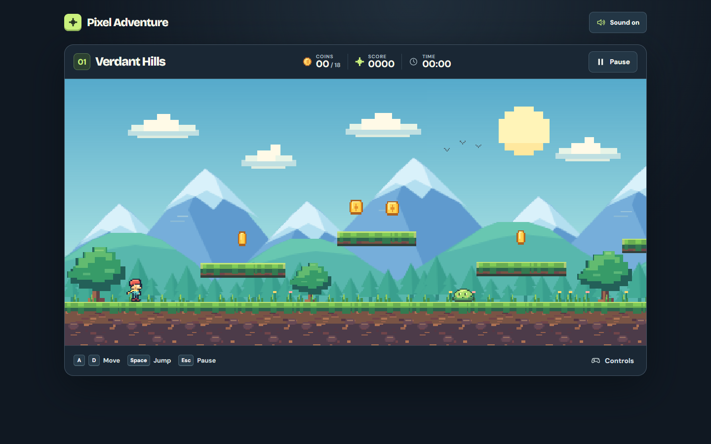

# Pixel Adventure 3.0 · Development

A free pixel-art platformer for browsers and Windows. The campaign has 30 stages across seven worlds, with keyboard and touch controls. This branch contains the private 3.0 release candidate. The links below lead to the public 2.0.0 release.

The private 3.0.0-rc.2 Ultimate Ninja candidate integrates Combat & Movement 3.0 across all 30 stages. The core abilities and Parry are available from Level 1. The hero has 43 hand-authored animation clips and a Shadow Skill Tree with 18 optional upgrades. The development server supports `?hero=legacy` for comparing the original hero.

[Play online](https://pixel-adventure-phi.vercel.app/) · [Download for Windows x64](https://github.com/soulaiman125/pixel-adventure/releases/download/v2.0.0/Pixel-Adventure-Setup-2.0.0-x64.exe) · [Release notes](https://github.com/soulaiman125/pixel-adventure/releases/tag/v2.0.0)



| Stages | World | New challenges |
| --- | --- | --- |
| 1–4 | Green Valley | Slimes, ledges, and ground spikes |
| 5–8 | Dangerous Canyon | Sandstone gaps, moving platforms, and falling rocks |
| 9–12 | Frozen Kingdom | Low-friction ice, ice slimes, icicles, and vanishing ledges |
| 13–16 | Fire Kingdom | Lava, fireballs, flame vents, and crumbling ledges |
| 17–20 | Dark Castle | Sweeping spikes, flying enemies, shooters, and the Hollow Crown |
| 21–25 | Poison Jungle | Poison pools and clouds, armored guards, and the Poison Queen |
| 26–30 | Thunder Fortress | Moving lasers, rising lava, electric floors, crushers, and the Thunder Titan |

## Run the browser game locally

Use Node.js 20.19+ on the 20.x line, or Node.js 22.12 or later, with npm. From the project folder in PowerShell:

```powershell
npm.cmd ci
npm.cmd run dev
```

Open [http://127.0.0.1:5173/](http://127.0.0.1:5173/). The browser version can also be served from the generated `dist/` folder on a static web server after running `npm.cmd run build`.

## Play on Windows

Download the setup executable from [GitHub Releases](https://github.com/soulaiman125/pixel-adventure/releases/tag/v2.0.0), close any open Pixel Adventure window, and run the installer on Windows x64. Open **Pixel Adventure** from the desktop or Start menu. Run the same installer over v1.0.0 to upgrade and retain your existing Windows save. The installer includes the runtime, game, and assets. It plays offline after installation and saves progress separately from the browser version.

To rebuild the installer on Windows, run `npm.cmd run package:win`. It writes the NSIS installer to `release/`. The installer is unsigned, so Windows SmartScreen may display a warning when it is opened. Distribute the setup executable as a single file. Building does not publish it.

To run the desktop edition from source, run `npm.cmd run build` followed by `npm.cmd run desktop`.

## Controls

| Action | Keyboard | Touch |
| --- | --- | --- |
| Move | A / D or Left / Right | Hold an arrow |
| Jump | W, Up, or Space | Press Jump |
| Katana Rush / Charged Slash | Tap / hold X or J | Tap / hold Attack |
| Shuriken | C or K | Tap ✦ |
| Shadow Dash | Z | Tap Dash |
| Shadow Sprint | Hold Left Shift | Hold Run or enable toggle in Settings |
| Blade Cyclone | V | Tap Spin |
| Shadow Execution | F | Tap Finish |
| Perfect Parry | Q | Tap Parry |
| Downward strike | Down + Attack in the air | Hold ↓ and tap Attack in the air |
| Drop through a ledge | S or Down | Walk off the edge |
| Pause | Esc | Tap Pause |
| Retry checkpoint | R | Pause → Retry Checkpoint |

Hold Jump for height. Stomp enemies or attack at close range while facing them. A frontal hit on an armored guard exposes it for a follow-up. Blinking ledges, outlined targets, and striped ground warn of incoming hazards. Green flags restore you to the last checkpoint with collected coins intact. A checkpoint retry counts as a death. Dodge boss attacks and strike when the health panel says **Attack now!** The finish flag opens when the boss is defeated.

Tap Attack again during recovery to queue the rising slash and heavy finisher, on the ground or in the air. A hold starts with an immediate slash and begins charging after 320 ms. Release to send a short-range wave, or hold until its automatic release. Damage and pause cancel a pending charge. Sprint reaches 176 world px/s from the normal 132 and keeps ordinary jump reach. Slide against marked solid walls and jump once before landing. A Wall Jump never refreshes an expended Air Dash.

Combat uses cooldowns. Base cooldowns are 350 ms for Shuriken, 700 ms for Ground Dash, 1.5 s for Charged Slash, 3 s for Cyclone, and 6 s on a valid Execution. Parry has a short frontal window for projectiles and marked melee attacks, with an 800 ms cooldown on a miss. A success opens a countercut. Dodge traps and attacks from behind. Settings supports key remapping.

On a standard gamepad, use the left stick or D-pad to move, A to Jump, X for Katana, Y for Shuriken, B for Parry, LB for Sprint, RB for Dash, LT for Cyclone, RT for Execution and Start to pause.

## Progress

Finish a level to unlock the next. Each coin earns 100 points. A finish earns one star, at least half the coins earns two, and collecting every coin earns three. Level Select keeps the best coin count, star rating, and completion time for each stage. Clear a stage without dying to earn a **No deaths** badge. Active runs reset on restart, while saved records and access are retained.

First time stage clears, boss clears, and challenge wins award Shadow Points. **Shadow Skill Tree** on the main menu shows all six upgrade tracks and their costs. A confirmed reset refunds the points. The skill save is versioned separately and existing cleared stages are credited when the game first reads them.

Stage clears earn a C, B, A, or S rank based on time, defense, combat, and coins. **Combat Trials** shows optional goals, unlock conditions and Survival personal bests. Six Survival clears in one run unlock the Dawn costume. Discover the two marked optional caches to unlock colors and earn Shadow Points.

Verdant Hills remains Level 1, Sunset Canyon is Level 5, and Crystal Peaks is Level 11. Earlier browser saves preserve access and records for those same stages. An existing Hollow Crown clear unlocks Level 21. A fresh adventure resets current campaign totals and preserves best records and unlocks. Final victory requires completing all 30 stages and defeating the Thunder Titan.

Settings stores separate music and effects volumes, mute, reduced motion, and extra danger outlines. Music starts after a player interaction. Reduced motion limits particles and camera shake. An operating system preference for reduced motion also applies. Extra danger outlines emphasize active hazards and show the travel area of moving lasers.

### Challenges

Use **Challenges** from the main menu. Runs use a separate local save and retain campaign unlocks and results. Challenge modes use the six base abilities and fixed loadouts so purchased upgrades cannot change records.

| Mode | Access and rules |
| --- | --- |
| Hardcore | Unlocked campaign stages, faster traps, and fewer checkpoints |
| Nightmare | Opens after The Hollow Crown. Adds laser grids, shorter boss openings, and the final checkpoint only |
| Boss Rush | Opens after all three campaign bosses. Fight them in separate arenas and carry time and deaths through the sequence |
| Time Trial | Replay any cleared campaign stage for a separate personal best |
| No-Death | Replay a cleared stage with one life. A checkpoint retry ends the attempt |

Clear Hardcore to earn Ember, No-Death to earn Frost, and Nightmare or Boss Rush to earn Storm. Choose earned outfits under Settings.

### Mobile controls

Hold an arrow with one thumb and tap Jump or Attack with the other. Slide directly between the arrows to change direction. Sliding off both arrows releases movement. Hold Jump for more height. Landscape gives you a wider view, and portrait remains playable.

Open **Settings** from the main menu or pause screen to change button size, opacity, handedness, action positions, or sprint behavior. Haptics and fullscreen appear when the browser supports them. Preferences are saved per browser or app.

### Private training arena

Open [Shadow Training Hall](http://127.0.0.1:5173/?shadow=arena) with the development server running. It includes enemies, a training boss, a collision corridor, an active laser, and an isolated skill profile. The debug overlay shows active frames, hitboxes, timing, and impacts. The production build omits the training entry point.

## Verification

```powershell
npm.cmd test
npm.cmd run test:browser
npm.cmd run test:touch
npm.cmd run test:campaign
npm.cmd run test:ninja
npm.cmd run test:performance
npm.cmd run build
npm.cmd run test:desktop
```

Run the browser suites with the development server running and Microsoft Edge installed. The browser smoke suite verifies scene loads and completion triggers with controlled player placement, plus real input for selected movement, combat, and touch checks. The separate `test:campaign` runner clears stages through keyboard inputs, checks each boss phase, and verifies the final Victory totals. `test:ninja` exercises combat, upgrades, remapping, touch inputs and the training arena. Install FFmpeg for its review-video exports. The desktop suite uses a temporary profile, samples offline audio, opens all 30 stages with networking disabled, and checks save persistence after relaunch.

Use `PIXEL_TEST_URL` to select a candidate server, `PIXEL_REPORT` for campaign evidence, and `PIXEL_REVIEW_DIR` for screenshots and benchmark output. The performance runner compares a separate Combat 2.0 build at `PIXEL_BASELINE_URL` with the candidate server. Set `PIXEL_EXECUTION_BENCH=1` for the finisher or `PIXEL_SURVIVAL_BENCH=1` for a six-enemy workload. See [the Ultimate Ninja QA report](docs/ultimate-qa.md).

## Credits

Character, enemy, terrain and combat animation frames are authored in the project's Canvas code. Sound effects and the seven original music themes are synthesized with Web Audio. The detailed world background plates were created with ImageGen. Their prompts and saved assets are recorded in [the artwork provenance](docs/campaign-art-provenance.md) and [the earlier visual prototype](docs/visual-prototype.md). [Phaser](https://phaser.io/) powers the game. [Vite](https://vite.dev/) builds the web edition, and [Electron](https://www.electronjs.org/) powers the Windows edition. The interface uses [Bricolage Grotesque](https://github.com/ateliertriay/bricolage) and [DM Sans](https://github.com/googlefonts/dm-fonts) via Fontsource.
